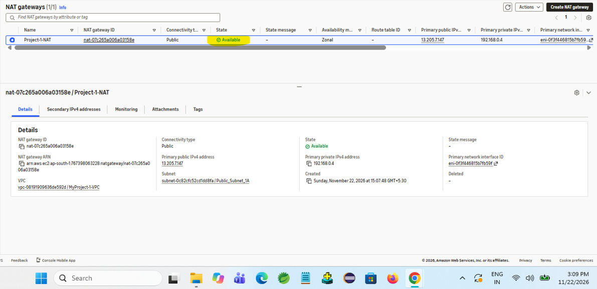
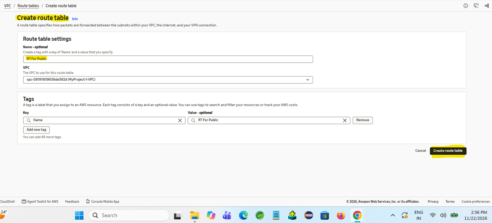
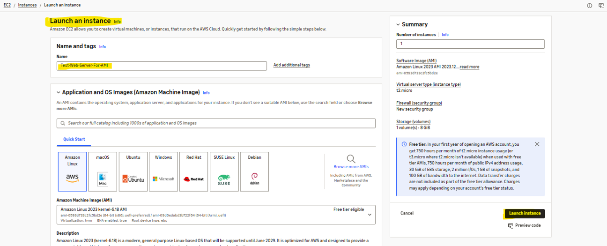
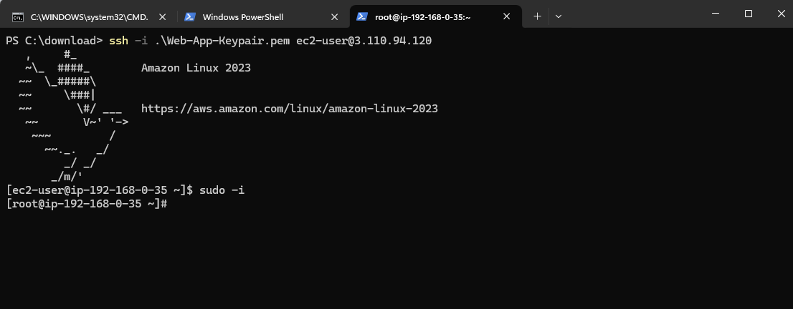
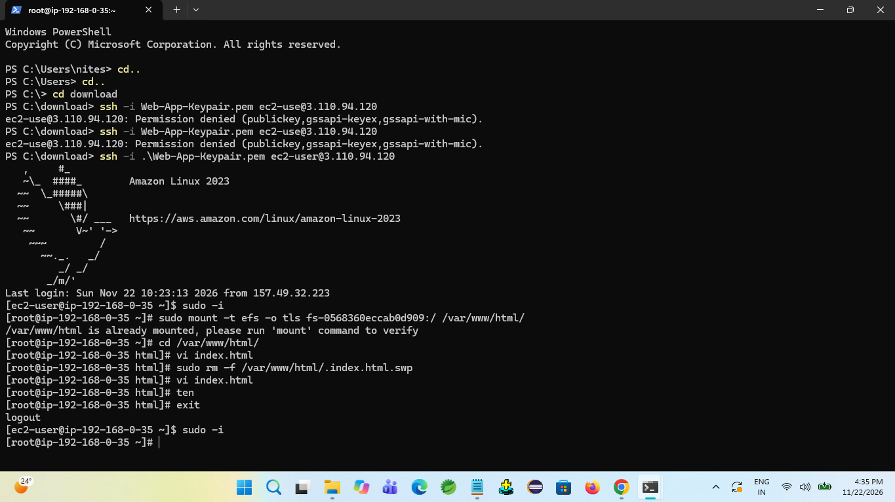
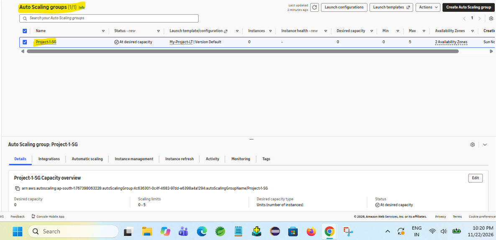
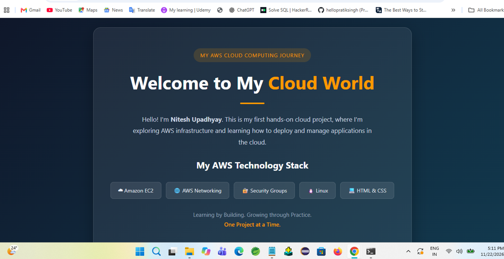

# Resilient and Scalable Web Application Deployment on AWS

## Project Overview

This project demonstrates the design and deployment of a highly available and scalable web application infrastructure using Amazon Web Services (AWS).

The infrastructure is designed using a custom Virtual Private Cloud (VPC), public and private subnets across multiple Availability Zones, EC2 instances, Elastic File System (EFS), Application Load Balancer (ALB), and Auto Scaling.

The primary objective is to improve application availability, scalability, security, and fault tolerance by following AWS networking and infrastructure best practices.

## Architecture Diagram

**AWS Region:** Asia Pacific (Mumbai) – ap-south-1

**Availability Zones:**
- ap-south-1a
- ap-south-1b

**VPC CIDR:** 192.168.0.0/24

## AWS Services Used

| AWS Service | Purpose |
|---|---|
| Amazon VPC | Created an isolated network environment |
| Public Subnets | Provided connectivity for internet-facing resources |
| Private Subnets | Hosted resources without direct public internet exposure |
| Internet Gateway | Enabled internet connectivity for public resources |
| NAT Gateway | Enabled outbound internet access from private subnets |
| Amazon EC2 | Hosted the web application |
| Amazon EFS | Provided shared file storage |
| Application Load Balancer | Distributed incoming application traffic |
| Auto Scaling | Automatically adjusted EC2 capacity |
| Security Groups | Controlled inbound and outbound traffic |
| Route Tables | Managed network traffic routing |

## Network Configuration

Created a custom VPC with the CIDR block `192.168.0.0/24`.

Configured four subnets across two Availability Zones.

| Subnet | CIDR | Availability Zone |
|---|---|---|
| Public Subnet 1A | 192.168.0.0/26 | ap-south-1a |
| Public Subnet 2B | 192.168.0.64/26 | ap-south-1b |
| Private Subnet 1A | 192.168.0.128/26 | ap-south-1a |
| Private Subnet 2B | 192.168.0.192/26 | ap-south-1b |

Configured an Internet Gateway, NAT Gateway, and route tables to manage communication between the subnets and the internet.

## Project Implementation Steps

### Step 1: Create a Custom VPC
- Created a custom VPC.
- Configured the IPv4 CIDR block.
- Selected the AWS Mumbai region.

### Step 2: Create Public and Private Subnets
- Created two public subnets.
- Created two private subnets.
- Distributed the subnets across two Availability Zones.

### Step 3: Configure Internet Gateway and NAT Gateway
- Created and attached an Internet Gateway to the VPC.
- Created a NAT Gateway in a public subnet.
- Configured connectivity for resources in private subnets.

### Step 4: Configure Route Tables
- Created and configured public and private routing.
- Associated route tables with their respective subnets.
- Configured internet and NAT gateway routes.

### Step 5: Launch EC2 Instances
- Launched EC2 instances.
- Configured security groups.
- Installed the required web server and application dependencies.
- Deployed the web application.

### Step 6: Configure Amazon EFS
- Created an EFS file system.
- Configured mount targets across the Availability Zones.
- Connected EC2 instances to shared storage.

### Step 7: Configure Launch Template and Auto Scaling
- Created a custom AMI/launch configuration as used in the project.
- Configured the Auto Scaling Group.
- Defined minimum, maximum, and desired capacity.
- Configured scaling policies.

### Step 8: Configure Application Load Balancer
- Created an internet-facing Application Load Balancer.
- Configured listeners and target groups.
- Registered the EC2 instances through the target group.
- Configured health checks.

### Step 9: Application Testing
- Tested application access through the ALB DNS endpoint.
- Verified target group health.
- Tested application availability.
- Verified Auto Scaling behaviour.

## Screenshots

### 1. VPC and Networking

### 2. Subnet Configuration

### 3. Internet Gateway

### 4. NAT Gateway

### 5. Route Tables

### 6. EC2 Instances

### 7. EFS Configuration

### 8. Auto Scaling Group

### 9. Application Load Balancer

### 9. Application Testing

## Key Learning Outcomes

- Hands-on experience with AWS networking and VPC architecture.
- Understanding of public and private subnet communication.
- Configuring Internet Gateway and NAT Gateway.
- Deploying web applications on EC2 instances.
- Understanding shared storage using Amazon EFS.
- Implementing load balancing using Application Load Balancer.
- Configuring EC2 Auto Scaling for application scalability.
- Troubleshooting connectivity and target group health issues.
- Understanding high availability across multiple Availability Zones.

## Future Enhancement

- Integrate Amazon Route 53 for custom domain management and DNS routing.

## Project Status

Core infrastructure deployment and application testing completed. Route 53 integration is planned as a future enhancement.

## Author

**Nitesh Upadhyay**

GitHub: [https://github.com/Niteshupadhyay085]

LinkedIn: [https://www.linkedin.com/in/nitesh-upadhyay08/]